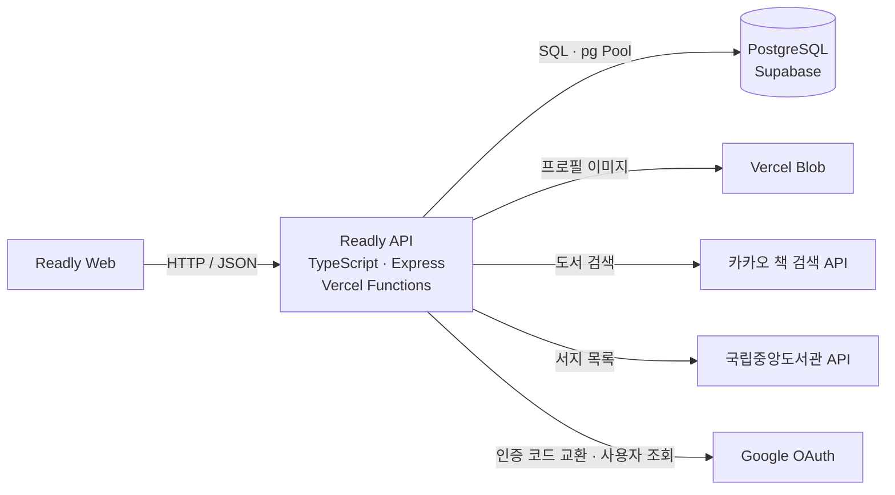

# Readly API

**읽은 책을 기록하고, 다른 독자의 생각을 발견하는 독서 기록 서비스의 백엔드입니다.**

책을 검색해 요약과 독서 구간을 남기고, 제목·저자·카테고리로 다른 사람의 기록을 탐색할 수 있습니다. Readly API는 이 흐름에 필요한 인증, 도서 정보 연동, 독서 기록과 댓글·좋아요, 프로필 이미지 저장을 제공합니다.

기능을 구현한 뒤에는 **SQL 조회 범위와 DB 왕복 횟수**, **외부 API 교체 시 응답 호환성**, **이미지 교체 실패 시 기존 데이터 보존**을 중심으로 개선했습니다.

[프론트엔드 저장소](https://github.com/Jii-Yeong/readly) · [설계와 문제 해결](#설계와-문제-해결) · [테스트](#테스트) · [로컬 실행](#로컬-실행)

## 주요 기능

| 사용자 흐름 | 제공 기능 |
| --- | --- |
| 책 찾기 | 카카오 도서 검색, 국립중앙도서관 서지 목록 조회 |
| 독서 기록 남기기 | 도서 정보·읽은 페이지 구간·카테고리를 포함한 요약 작성과 수정·삭제 |
| 다른 독자의 기록 탐색 | 제목·저자·카테고리 검색, 최신순·조회순·좋아요순 목록, 댓글과 좋아요 |
| 내 프로필 관리 | 일반·Google 로그인, 닉네임과 프로필 이미지 변경 |

## 시스템 구조



| 구분 | 기술과 적용 방식 |
| --- | --- |
| API | Node.js 24, TypeScript, Express — 인증·사용자·도서·댓글 라우터로 구성 |
| 데이터 | PostgreSQL, `pg` — 파라미터 바인딩과 직접 작성한 SQL로 조회·집계 제어 |
| 인증 | JWT, bcryptjs, Google OAuth — 비밀번호 해싱과 액세스 토큰 발급 |
| 파일 저장 | Vercel Blob — 이미지 파일은 Blob에, 참조 URL은 DB에 저장 |
| 배포 | Vercel Functions — 서울 리전(`icn1`), 실행 인스턴스 내 DB 커넥션 풀 재사용 |
| 검증 | Node.js 내장 테스트 러너 — DB·외부 API·스토리지 모킹을 통한 회귀 테스트 |

## 설계와 문제 해결

### 1. 목록 조회의 집계 범위와 DB 왕복 횟수 줄이기

독서 기록 목록은 작성자·카테고리 정보와 댓글·좋아요 수를 함께 보여줍니다. 목록 조회와 부가 정보 집계를 분리해, 한 페이지를 가져오기 위해 처리하는 범위를 조절했습니다.

- **페이지를 먼저 조회:** 최신순·조회순 목록과 검색은 CTE에서 `LIMIT`·`OFFSET`을 적용한 기록에 댓글·좋아요 수를 붙입니다.
- **필터에 맞춰 집계:** 카테고리·사용자로 필터된 좋아요순 목록은 해당 기록의 좋아요만 집계한 뒤 순위를 계산합니다.
- **한 번의 SQL 호출로 처리:** 목록과 전체 건수를 함께 조회합니다. 요약·댓글 작성은 `INSERT ... SELECT`로 사용자 확인과 저장을, Google 로그인은 `ON CONFLICT`로 신규·기존 사용자 처리를 결합했습니다.
- **요청당 작업량 제한:** 요약 목록·검색의 페이지 크기는 최대 100건으로 제한하고, 잘못된 페이지 입력은 DB 조회 전에 거절합니다. 공개 카테고리·인기 도서 조회에는 캐시 헤더를 적용했습니다.

쿼리 호출 수, 바인딩된 입력값, 필터별 집계 SQL과 빈 페이지의 전체 건수 유지를 테스트합니다. 실제 운영 지연 시간과 실행 계획은 별도 측정 대상으로 두고 있습니다.

구현: [도서 라우터](api/book.ts) · [DB 연결과 SQL 바인딩](utils/sql.ts) · [회귀 테스트](tests/performance.test.cjs)

### 2. 도서 검색 공급자를 바꿔도 클라이언트 계약 유지하기

네이버 기반 검색을 카카오로 교체하면서 기존 클라이언트가 사용하는 `items`, `start`, `display` 형식을 유지했습니다. 공급자마다 다른 페이지 규칙과 필드 이름은 서버에서 변환합니다.

- 요청 구간이 여러 공급자 페이지에 걸치면 필요한 페이지를 병렬 조회하고, 요청한 행 범위만 반환합니다.
- ISBN·저자·발행일·가격을 기존 응답에 맞추고, 마지막 페이지가 반복되는 경우 결과가 중복되지 않도록 처리합니다.
- 국립중앙도서관 서지 목록은 검색과 별도 엔드포인트로 제공하며, 페이지·기간·납본 여부 등의 입력을 검증합니다.
- 도서 API 요청에 10초 타임아웃을 적용하고, 잘못된 입력(`400`), 키 미설정(`500`), 공급자 장애·잘못된 응답(`502`)을 구분합니다. 공급자의 오류 본문은 클라이언트에 노출하지 않습니다.

구현: [도서 API 연동](utils/book.ts) · [검색 호환성 테스트](tests/book-search.test.cjs) · [서지 목록 테스트](tests/nl-book.test.cjs)

### 3. 이미지 교체 도중 실패해도 기존 프로필 보존하기

DB와 파일 스토리지는 하나의 트랜잭션으로 묶을 수 없으므로, 실패했을 때의 상태를 기준으로 저장 순서를 정했습니다.

**새 이미지 업로드 → DB의 이미지 URL 변경 → 이전 이미지 정리**

업로드나 DB 저장이 실패하면 기존 이미지를 삭제하지 않습니다. DB 저장 이후 이전 파일 정리에 실패하더라도 새 프로필 저장은 성공으로 처리합니다. 다른 저장소의 이미지는 삭제 대상에서 제외하며, 파일 유형·크기와 사용자 인증을 먼저 확인합니다.

이 순서는 기존 이미지 유실을 피하는 대신, DB 저장 실패 시 사용하지 않는 새 업로드가 남을 수 있습니다. 파일 정리 작업은 후속 개선 과제로 남겼습니다.

구현: [프로필 이미지 저장](api/user.ts) · [실패 단계별 테스트](tests/profile-image.test.cjs)

## 테스트

```bash
yarn install --frozen-lockfile
npm test
```

현재 **60개 테스트**로 다음 동작을 검증합니다. 실제 DB나 API 키 없이 실행할 수 있습니다.

| 검증 대상 | 확인하는 동작 |
| --- | --- |
| SQL 처리 | 쿼리 호출 수, 필터 바인딩, 페이지 제한, 빈 결과에서도 전체 건수 유지 |
| 도서 API | 100권 요청·중간 행부터 조회, 마지막 페이지 중복 방지, 잘못된 응답·타임아웃 처리 |
| Google 로그인 | 인증 코드·토큰·사용자 정보 검증, 외부 통신·DB 실패 시 응답 |
| 프로필 이미지 | 업로드·DB 저장·이전 파일 삭제 순서, 각 단계의 실패, Blob SDK의 OIDC 인증 경로 |
| 응답과 접근 정책 | 비밀번호 해시 응답 제외, 허용한 Origin에만 CORS 헤더 제공 |

테스트는 핸들러와 SQL·외부 연동 경계의 동작을 검증합니다. 실제 PostgreSQL 실행 계획, 운영 부하, 배포 환경의 업로드 성공 여부는 별도로 확인해야 합니다.

## 주요 API

전체 라우트는 [api/](api/)에서 확인할 수 있습니다. 아래는 서비스의 주요 진입점입니다.

| 영역 | 메서드·경로 | 설명 |
| --- | --- | --- |
| 인증 | `POST /auth/sign-up`, `POST /auth/login` | 일반 회원가입·로그인 |
| 인증 | `POST /auth/login/google` | Google 인증 코드로 로그인 |
| 도서 | `GET/POST /book/search` | 카카오 도서 검색 |
| 도서 | `GET/POST /book/list` | 국립중앙도서관 서지 목록 조회 |
| 독서 기록 | `POST /book/summary/create`, `PUT /book/summary/edit`, `DELETE /book/summary/delete` | 요약 작성·수정·삭제 |
| 독서 기록 | `GET /book/summary/list`, `GET /book/summary/search` | 정렬·필터·검색과 페이지 조회 |
| 소셜 | `POST /book/summary/click-like`, `POST /comment/create` | 좋아요 전환·댓글 작성 |
| 사용자 | `GET /user/my-info`, `POST /user/edit/profile-image` | 내 정보 조회·프로필 이미지 변경 |

## 로컬 실행

Node.js **24.x**, Yarn Classic **1.x**, Vercel CLI가 필요합니다.

```bash
git clone https://github.com/Jii-Yeong/readly-api.git
cd readly-api
yarn install --frozen-lockfile
```

프로젝트 루트에 `.env.development.local`을 만들고 사용할 기능에 맞는 환경 변수를 설정합니다. Vercel 프로젝트 접근 권한이 있다면 `vercel link` 후 `vercel env pull .env.development.local --environment=development`로 가져올 수 있습니다.

| 환경 변수 | 용도 |
| --- | --- |
| `SUPABASE_POSTGRES_URL` | PostgreSQL 연결 문자열. `POSTGRES_URL` 또는 `DATABASE_URL`도 지원 |
| `JWT_SECRET_KEY` | 액세스 토큰 서명·검증 |
| `CLIENT_URL` | 추가로 허용할 프론트엔드 Origin |
| `KAKAO_REST_API_KEY` | 카카오 도서 검색 |
| `NL_ISBN_API_KEY` | 국립중앙도서관 서지 목록 조회 |
| `GOOGLE_CLIENT_ID`, `GOOGLE_CLIENT_SECRET`, `GOOGLE_REDIRECT_URI` | Google 로그인 |
| `BLOB_STORE_ID` 또는 `BLOB_READ_WRITE_TOKEN` | 프로필 이미지용 Blob 저장소 인증 설정. OIDC는 Vercel에서 제공하는 토큰도 필요 |

```bash
yarn dev
# http://localhost:3002
```

Vercel CLI는 별도 설치가 필요합니다. DB를 사용하는 기능은 기존 스키마가 준비된 PostgreSQL에 연결해야 합니다. 현재 저장소에는 스키마 생성·마이그레이션 스크립트가 포함되어 있지 않습니다.

<details>
<summary>도서 API·CORS·이미지 저장 설정 상세</summary>

### 도서 API

- `GET/POST /book/search`: `query` 필수. `display` 또는 `size`는 기본 10, 최대 100이고 `start`는 1부터 시작하는 행 위치(최대 2500)입니다. `page`를 쓰면 1~50 페이지, 최대 50의 페이지 크기를 사용합니다.
- `GET/POST /book/list`: `page_no`는 1부터, `page_size`는 기본 20·최대 100입니다. `/book/all`, `/book/nl-list`는 같은 GET 핸들러를 사용하며 전체 목록을 한 번에 반환하지 않습니다.
- 국립중앙도서관 가격은 `REAL_PRICE`, `PRE_PRICE` 순서로 사용합니다. `PUBLISH_PREDATE`는 발행예정일이며, 이미지 등 서지정보가 비어 있을 수 있습니다.

### CORS

운영 프론트엔드 `https://readly-steel.vercel.app`와 로컬 개발 주소는 [허용 목록](api/index.ts)을 따릅니다. 추가 프론트엔드 도메인은 `CLIENT_URL`에 정확한 Origin을 설정합니다. 다른 하위 도메인은 자동 허용하지 않습니다.

### 프로필 이미지

- 운영 프로젝트에 Public Blob 저장소를 연결합니다. OIDC 방식은 `BLOB_STORE_ID`와 Vercel이 제공하는 OIDC 토큰을 사용합니다. 로컬에서는 Development 환경에도 Blob을 연결하고 환경 변수를 가져옵니다. 만료되는 OIDC 토큰을 직접 복사해 고정하지 않습니다.
- 파일은 Blob에, URL은 PostgreSQL의 `users.profile_image`에 저장하므로 DB와 Blob 연결을 각각 설정해야 합니다.
- Vercel Function의 요청 본문 제한은 4.5 MB입니다. multipart 헤더를 고려해 4 MB 이하 이미지를 권장합니다. 더 큰 파일은 Blob 직접 업로드 방식이 필요합니다. [Vercel 공식 안내](https://vercel.com/kb/guide/how-to-bypass-vercel-body-size-limit-serverless-functions)

</details>

## 다음 개선 과제

- 실제 데이터로 `EXPLAIN ANALYZE`와 부하 테스트를 수행해 목록·검색의 병목과 응답 시간 측정
- DB 스키마·마이그레이션 관리와 실제 PostgreSQL 통합 테스트 추가
- 인증·입력 검증·오류 응답 정책을 공통 미들웨어로 정리
- Blob 직접 업로드와 사용하지 않는 파일 정리 작업 도입
